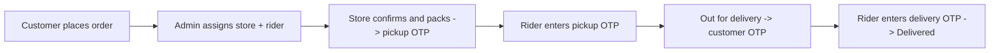

# Medix – Bottleneck Analysis & Improvement Roadmap

Model: "Zomato for medicines" – customer orders → admin assigns store + rider → store confirms & packs (pickup OTP) → rider picks up → delivery with customer OTP.
Goal: **so simple that any age group (including elders and first-time smartphone users) can order.**

Based on a review of `apps/customer` (React/Vite PWA: Search, Cart, Orders, Account, OrderSuccess, Admin/Rider/Pharmacy dashboards) and `server` (Express + MongoDB: auth, orders, medicines, cart, admin, rider, pharmacy routes).

---

## 1. Current Flow (as built)

The OTP handoffs and the "rider cannot see the order until packed" rules are solid trust features. The bottlenecks are mostly **speed, ordering friction, reliability and scale**.

---

## 2. Bottlenecks (ordered by business impact)

### Critical

| # | Bottleneck | Why it hurts | Evidence in code |
|---|-----------|--------------|------------------|
| 1 | **Manual admin assignment of every order** | Admin is the single point of failure. Every order waits for a human to pick a store + rider. Cannot scale past a few dozen orders/day; nights/holidays = dead orders. | `AdminDashboard.jsx` (1040 lines, manual assign flow); order stays `SEARCHING` until admin acts |
| 2 | **No auto-reassign when a store ignores/declines** | Store decides whether to take it, but there is no timeout, so the order can sit forever. | No timer/retry logic in `orderRoutes.js` / `pharmacyRoutes.js` |
| 3 | **Polling instead of real-time push** | Customer polls every 8 s, rider/pharmacy every 10 s. Slow updates, wasted load, stores miss new orders. | `useOrders.js` `refetchInterval`, `setInterval(..., 10000)` in Rider/Pharmacy dashboards |
| 4 | **No push notifications / SMS / WhatsApp** | Store owners won't keep a tab open. Customers get no "packed / on the way / OTP" alert. | No notification service in `server/src/services` |
| 5 | **Customer login OTP is hard-coded `1234`** and returned in the API response | Anyone can log in as any phone number and see addresses/orders – serious privacy/fraud risk for medicine data. | `authRoutes.js`: `const otp = '1234'` |
| 6 | **Weak security basics** | JWT secret has a hard-coded fallback; `/orders?phone=` lets anyone read any customer's orders; in-memory OTP cache is lost on restart and breaks with multiple servers. | `JWT_SECRET \|\| '...'`, `useOrders.js` phone param, `otpCache = new Map()` |
| 7 | **Prescription not enforced** | Rx medicines are only a boolean flag; no image stored, no pharmacist verification. Legal/compliance risk (Schedule H/H1). | `requiresRx`, `prescriptionUploaded` booleans only |
| 8 | **Silent fake order on API failure** | If `POST /orders` fails, `Cart.jsx` builds a local `MDX-xxxxxx` order and shows success – customer thinks the order is placed but it is not. | `Cart.jsx` ~L180 |

### High

| # | Bottleneck | Why it hurts |
|---|-----------|--------------|
| 9 | **Typing-heavy ordering** | Elders/low-literacy users struggle with exact spelling, brand vs generic names. |
| 10 | **No live rider tracking / real ETA** | Only static "within 24 hrs". Zomato-style trust comes from live ETA. |
| 11 | **Cash on Delivery only** | Excludes UPI users, increases rejection/fraud, riders carry and reconcile cash. |
| 12 | **No per-store stock awareness** | Assigned store may not have the medicine; discovered after order placed → cancellations. |
| 13 | **Free-text address (Village/PO + PIN)** | No GPS/map pin; riders get lost, serviceability/fee can't be computed accurately. |
| 14 | **English only** | Target users prefer Bengali / Hindi / Nepali. |
| 15 | **No substitution / out-of-stock flow** | Store cannot propose a replacement to the customer. |

### Medium

| # | Bottleneck | Notes |
|---|-----------|-------|
| 16 | No rider/store earnings, payout & COD reconciliation | Needed for partner retention. |
| 17 | No ratings / feedback / working help flow | "Need help" is only a toast. |
| 18 | Very large components (`AdminDashboard` 1040 lines, `Cart` 562) | Hard to maintain; regressions (e.g. reported Order Success "Done" button issue). |
| 19 | Single ~567 kB JS bundle | Admin/rider/pharmacy code ships to customers; slow on weak networks. |
| 20 | No tests, error tracking, documented backups | Production risk. |
| 21 | Order IDs from `Date.now().slice(-6)` | Collision-prone at scale. |

---

## 3. Simplicity Plan – "Any Age Can Order"

### 3.1 Order in 3 taps
1. **One-tap reorder** on the home screen from the last order (elders usually repeat the same medicines).
2. **"My medicines" / monthly refill list** with a reminder ("BP medicine due in 3 days").
3. **Order by photo** of prescription or medicine strip – camera button on home; admin/pharmacist builds the cart, customer just confirms. Removes typing/spelling problems.
4. **Voice search** (Web Speech API; Bengali/Hindi/English).
5. **Call / WhatsApp to order** – a big "Call to order" button; admin creates the order on the customer's behalf.

### 3.2 Reduce screen complexity
- One primary action per screen, large buttons (min 48 px), larger default font (16–18 px), high contrast, a "Bigger text" toggle.
- Home = 3 big cards: **Search medicine · Upload prescription · Reorder**.
- Smart search: typo-tolerant; by brand, generic/salt and symptom ("fever", "gas", "BP"); suggest cheaper generic equivalents; show pack size clearly.
- Cart: one total, one button; bill breakup behind "See details".
- Replace **swipe-to-confirm** with a single large Confirm button (swipe is hard for many seniors).
- Plain words for statuses: "Store is packing your medicines". One-line OTP explanation: *"Tell this number to the delivery person only when you receive your medicines."* Show the delivery OTP very large.

### 3.3 Simple sign-in
- Phone + real SMS OTP, **remember the device 30–90 days** (refresh token).
- **Family accounts**: a son/daughter orders for a parent; parent's phone gets the delivery OTP.
- Address: "Use my current location" + map-pin confirm + one landmark field; saved Home / Parent's home.

### 3.4 Language & accessibility
- Language picker on first launch (বাংলা · हिन्दी · नेपाली · English).
- Screen-reader labels, big tap targets, never rely on colour alone for status.
- Optional short how-to video/audio on first launch.

### 3.5 Trust
- Show licensed pharmacy name and drug licence number on the order.
- Clear refund/return policy; a working Help button (call/WhatsApp support).
- Price transparency: MRP vs price, delivery fee visible **before** checkout.

---

## 4. Operations & Platform Improvements

### 4.1 Automate dispatch (biggest scalability win)
1. Auto-assign the nearest open pharmacy that has the items (pincode first, later Mongo `2dsphere`).
2. Offer with a **timeout (~3 min)** → cascade to the next store → finally fall back to the admin queue.
3. Auto-assign nearest free rider after "packed" (offer → accept timeout → next rider). Admin keeps manual override.
4. Store open/closed/busy toggle and operating hours.
5. Per-store in-stock toggle per medicine (quantities later).

### 4.2 Real-time + notifications
- Replace polling with **Socket.IO / SSE**.
- **Web push/FCM + SMS/WhatsApp** (MSG91 / Twilio / Gupshup) for: placed, accepted, packed, out for delivery (+OTP), delivered.
- Loud sound + vibration + reminders for unaccepted orders in the pharmacy panel.

### 4.3 Tracking & ETA
- Rider shares GPS every 10–15 s → live map + ETA ("Arriving in ~12 min").
- Replace "within 24 hrs" with distance + prep-time based ETA.
- Order timeline with timestamps.

### 4.4 Payments & money
- UPI/cards (Razorpay/Cashfree); keep COD with a limit for new users.
- Auto-calculate rider payout, store settlement, platform commission; daily COD ledger.
- Coupons / first-order discount / free delivery threshold.

### 4.5 Prescription compliance
- Store Rx image (S3/Cloudinary) with the order.
- Pharmacist approve/reject step before packing.
- Block Schedule H/H1 without approved Rx; keep purchase register.
- Rider checks hard-copy Rx for restricted drugs at delivery.

### 4.6 Substitution & partial fulfilment
- Store marks line items unavailable → customer is notified: replace / remove / cancel; bill updates automatically.

---

## 5. Technical Hardening

| Area | Action |
|------|--------|
| Auth | Real SMS OTP, rate-limit + expiry in Redis/Mongo TTL, never return OTP in response, JWT (access+refresh) for customers, remove default `JWT_SECRET` (fail on boot if missing). |
| Authorization | Orders endpoints use JWT user id, not `?phone=`. Role middleware (customer/pharmacy/rider/admin). Replace admin PIN with admin accounts + 2FA. |
| API safety | `helmet`, CORS allow-list, `express-rate-limit`, validation (zod/joi). |
| Orders | Server-side unique IDs (counter/nanoid), idempotency key against double taps, **remove fake-order fallback** and show retry instead. |
| Data | Indexes on `status`, `pharmacy`, `rider`, `placedAt`; geo index; daily backups + restore drill. |
| Performance | `React.lazy` route splitting (customer vs admin/rider/pharmacy), vendor chunking, image compression, Mongo text index / Meilisearch for typo-tolerant search. |
| Code quality | Split `AdminDashboard`/`Cart` into components/hooks; ESLint/Prettier; Vitest + Playwright tests for the order flow and both OTP handoffs. |
| Observability | Sentry, structured logs, uptime checks, funnel analytics (search → cart → placed → delivered). |
| Apps | Separate installable PWAs for customer, store and rider. |
| Infra | HTTPS auto-renew, health checks, CI/CD, staging environment. |

---

## 6. Admin Panel Improvements
- Order queue with filters and **SLA timers** (red if unaccepted > 3 min / unpicked > 10 min).
- One-click re-assign store/rider, cancel with reason, refund.
- Create order on behalf of phone customers.
- KPIs: orders/day, acceptance rate, prep time, delivery time, cancellation reasons, COD pending, top medicines.
- Partner management: activate/deactivate, reset password, service areas, document verification (drug licence, driving licence, ID).
- Audit log of all status changes.

---

## 7. Prioritised Roadmap

### Phase 0 – Fix now (1–3 days)
1. Fix Order Success "Done" button flow and invalidate/refetch `['orders']` after placing.
2. Remove the fake-order fallback in `Cart.jsx`.
3. Stop returning the OTP in the API; remove default JWT secret.
4. Secure `/orders` by JWT user instead of `?phone=`.
5. Larger default font; replace swipe-to-confirm with a big button.

### Phase 1 – Dependable (2–4 weeks)
1. Real SMS OTP + customer JWT with long sessions.
2. Real-time updates + push + SMS.
3. Store accept timeout + auto-cascade.
4. Rx image upload + pharmacist verification.
5. Per-store stock toggle + item-unavailable flow.
6. Code splitting + tests for the order flow.

### Phase 2 – Simple & delightful (1–2 months)
1. Home with Search · Upload Prescription · Reorder.
2. Voice + typo/symptom search + generic alternatives.
3. Multi-language + Bigger text.
4. GPS address, saved addresses, family accounts.
5. Live rider tracking + real ETA.
6. UPI + coupons; monthly refill reminders.

### Phase 3 – Scale
1. Geo-based auto rider assignment, batching.
2. Settlement/payout automation.
3. Ratings, support tickets, analytics, referrals.
4. Chronic-care subscriptions, teleconsultation, lab tests.

---

## 8. Success Metrics
| Metric | Target |
|--------|--------|
| Taps from open → order placed (repeat user) | ≤ 3 |
| Order placed → store accepted | < 3 min |
| Order placed → delivered | < 60 min urban, < 3 h rural |
| Store acceptance rate | > 90 % |
| Orders needing admin intervention | < 10 % |
| Cancellation rate | < 5 % |
| First-time checkout completion | > 60 % |
| App load on 4G | < 3 s |

---

## 9. Key Takeaway
The trust mechanics (store confirm → pickup OTP → delivery OTP) are already stronger than most small delivery apps. Growth is blocked by **(a) manual admin dispatch, (b) no real-time/notifications, (c) weak customer auth/security, and (d) too much typing and too many steps for non-tech users.** Fix those in that order, then add photo-prescription ordering, one-tap reorder, local languages and a bigger-text UI for the simplest possible experience at any age.
